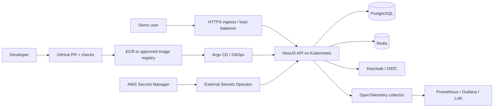

# SecureCloud Enterprise — Project Blueprint

> **Document role:** The authoritative, stable specification for Project #1. Read this before proposing architecture or implementation. Do not silently replace the business scenario or the committed technology stack.
>
> **Version:** 1.0.1 · **Status:** Proposed baseline awaiting initial architecture approval · **Last reviewed:** 2026-10-26

## 1. Identity and mission

- **Project:** Enterprise Secure Cloud-Native Platform
- **Codename:** SecureCloud Enterprise
- **Domain:** Fictional digital financial services; **no real money, real customer PII, or production financial credentials**.
- **Engineer role:** Own platform architecture, infrastructure, secure delivery, workload identity, Kubernetes operations, observability, incident handling, reliability, recovery and engineering evidence.
- **Primary goal:** Become capable of explaining, implementing, testing, securing, operating and troubleshooting an enterprise DevSecOps platform—not merely installing tools.
- **Related future projects:** Project #2 *Secure Delivery Factory* will extract and generalize reusable CI/CD and supply-chain workflows; Project #3 *Cloud Security Operations* will extend runtime detection and response. Project #1 must be functional independently.

### Business scenario

A financial services company serves thousands of fictional customers. Its web/API platform provides customer registration/login, customer accounts, **simulated** transactions, notifications, audit events and administrator operations. Engineers release changes several times weekly. The company requires traceable deployments, least-privilege access, vulnerability prevention, secrets management, resilient service, telemetry and disaster recovery. The learner builds the secure operating environment and a small realistic application to demonstrate it.

### Measurable end-state outcomes

1. A documented threat model and architecture with explicit trust boundaries and cost estimates.
2. Reproducible local platform and reproducible AWS environment built with Terraform, without manually configuring critical resources.
3. Containerized API and supporting services with meaningful health checks, tests, and secure configuration.
4. Kubernetes deployments packaged with Helm and reconciled through Argo CD GitOps.
5. Secure delivery using GitHub Actions, automated tests and security scans; Jenkins comparison lab.
6. OIDC-based authentication, authorization, safe secrets retrieval and workload identity.
7. Admission/policy enforcement, artifact scanning, SBOM generation and signature verification.
8. Metrics, dashboards, centralized logs, traces, alerts and operational runbooks.
9. Demonstrated failure drills, backup/restore and documented recovery results.
10. Public-safe portfolio README, clear Git history, reproducible commands and evidence of tests.

## 2. Scope and guardrails

**In scope:** An educational non-production platform using mock financial records and simulated transfers, cloud networking, IAM, containers, orchestration, GitOps, secure delivery, supply-chain controls, monitoring and recovery. **Out of scope:** Actual financial transactions, real customer data, payment gateways, real banking credentials, compliance certification, production financial-grade guarantees or pretending a lab is PCI DSS certified.

- Use synthetic data and test identities only.
- Design for production principles, but label any unimplemented controls as planned.
- Build **local-first** with WSL2 Ubuntu, Docker and kind/k3d; AWS resources are **optional time-boxed labs** requiring a cost estimate and explicit user approval.
- Do not provision EKS, NAT gateways, load balancers, RDS or other potentially billable resources without approval and a cleanup plan.
- Do not commit `.env`, private keys, secrets, Terraform state, credentials or sensitive screenshots/logs.
- Tool versions and AWS prices change; verify current official documentation before installation or cost claims.

## 3. Reference application

**Default baseline:** NestJS + PostgreSQL + Redis. **Alternative:** Spring Boot instead of NestJS only after an explicit documented architecture decision. Do not build both full backends by default.

**Logical modules:**

| Module | Purpose | Suggested demonstrable controls |
|---|---|---|
| Identity / Auth | Sign-in via OIDC provider | Token validation, roles, session handling |
| Customer accounts | Mock account balances/profiles | Input validation, access control, ownership checks |
| Simulated transactions | Transfers between synthetic accounts | Idempotency, transaction boundaries, audit trail |
| Notifications | Async mock notification events | Redis-backed queues/pub-sub; retry and failure handling |
| Audit | Append-only-style event trail | Actor, action, timestamp, correlation ID; redaction |
| Administration | Restricted administrative actions | RBAC, authorization tests, audit logs |
| Health / readiness | Probe dependencies and service readiness | Liveness/readiness/startup probes |

Start as a **modular monolith** with clear module boundaries; split into services only if justified by an architecture decision. PostgreSQL is the system of record; Redis is cache/queue/pub-sub as appropriate, **not** a substitute for durable transaction records. Avoid making a mock banking application unnecessarily complex.

## 4. Exact technology stack and learning contract

The following is the agreed stack. Where alternatives are shown, select one with an Architecture Decision Record (ADR), preserving the other as an evaluated option.

| Layer | Technologies to implement or evaluate | Why it belongs |
|---|---|---|
| Application | **NestJS or Spring Boot**, **PostgreSQL**, **Redis** | Realistic API, durable data, caching/async messaging |
| Development | **Git**, **Python**, **Bash**, **pre-commit** | Version control, automation, developer-side quality gates |
| CI | **GitHub Actions** initially; **Jenkins comparison** | Automated validation; understand CI platform tradeoffs |
| Cloud | **AWS VPC, EC2, IAM, EKS, ECR, S3** | Network, compute, identity, Kubernetes, registry, object storage |
| Infrastructure as Code | **Terraform**, **Ansible** | Reproducible provisioning and configuration automation |
| Containers | **Docker**, **BuildKit** | Reproducible builds and runtime isolation |
| Orchestration | **Kubernetes**, **Helm** | Scheduling, scaling, packaging and release configuration |
| Delivery | **Argo CD**, **GitOps** | Declarative deployment reconciliation and auditability |
| API / ingress | **AWS Load Balancer Controller**, **Ingress or Gateway API** | Controlled external traffic routing and TLS |
| Authentication | **Keycloak**, **OIDC** | Centralized identity, authentication and tokens |
| Secrets | **AWS Secrets Manager**, **External Secrets Operator** | Centralized secret storage and Kubernetes synchronization |
| Policy | **Kyverno or OPA Gatekeeper** | Admission policy and compliance-as-code |
| Security scans | **Semgrep, Trivy, Checkov, Gitleaks** | SAST, image/dependency scanning, IaC scanning, secret detection |
| Supply chain | **Syft, Cosign, SBOM** | Component inventory, artifact signing and verification |
| Observability | **Prometheus, Grafana, Loki, OpenTelemetry** | Metrics, dashboards, logs, traces and service insight |
| Reliability | **HPA, PDB, backups, recovery drills** | Scaling, disruption management, recoverability |

**Additional supporting tools where needed:** `kubectl`, kind or k3d, AWS CLI, `psql`, `curl`, `jq`, Docker Compose, GitHub CLI, Helm lint/test, kubeconform, and test tooling. These support the exact stack; they do not change the project concept.

**Important distinctions:** SBOM is an artifact, not a scanner; Syft generates SBOMs. Cosign signs/verifies artifacts. OIDC user authentication (Keycloak) is distinct from AWS workload identity (IAM roles / EKS Pod Identity or IRSA, selected after reviewing current AWS guidance). Ingress and Gateway API are alternatives, not necessarily both deployed. Prometheus/Grafana/Loki/OpenTelemetry are complementary rather than interchangeable.

## 5. Target architecture and trust boundaries

**Boundary A:** Public clients → TLS ingress → application authorization. **Boundary B:** Application → private data and cache. **Boundary C:** GitHub CI → signed images and controlled registry. **Boundary D:** GitOps controller → cluster changes. **Boundary E:** AWS identities → scoped cloud permissions and secrets. **Boundary F:** Observability → redacted logs and restricted dashboards.

**Local environment:** WSL2 Ubuntu + Docker + kind/k3d + local PostgreSQL/Redis + local Keycloak; emulate or stub cloud-only integrations where needed. **AWS lab environment:** Terraform-managed VPC, private/public subnets, route tables, security groups, IAM, ECR, S3, EC2 learning exercise, EKS when approved. Use a documented cost/cleanup checklist for every cloud experiment. For a low-cost intermediate phase, compare self-managed Kubernetes on EC2 versus EKS but do not misrepresent them as equivalent managed services.

### Security baseline

- Branch protection and PR review; least-privilege CI permissions; prefer short-lived OIDC credentials over long-lived AWS keys.
- No public PostgreSQL/Redis endpoints; private network placement and restricted security groups.
- Workload identity, role-based authorization, secret rotation plan and no secrets in Git.
- Container non-root, minimal image, pinned dependencies, health probes, resource requests/limits, read-only filesystem where feasible.
- SAST/SCA/IaC/secret/image scanning; document severity thresholds and false-positive handling.
- SBOM, artifact signature, policy checks and promotion rules; show a deliberate rejection test.
- Logging with PII redaction, correlation IDs, access controls and retention policy.
- Backup encryption, restore tests, recovery objectives and teardown plans.

## 6. Delivery phases and checkpoints

> These are the **canonical phases**. Do not invent a different project roadmap without user approval. Estimated pace is flexible; optimize for understanding and verified results, not a calendar deadline. Each phase contains multiple small tasks and should end with a demonstrable Git checkpoint.

| Phase | Name | Required technologies and deliverable | Completion evidence |
|---|---|---|---|
| **00** | Baseline and safe reset | WSL2, VS Code, Git, repo structure, AGENTS/docs | Correct Linux path, clean Git setup, docs synchronized |
| **01** | Business architecture and threat model | Financial demo requirements, architecture, trust boundaries, STRIDE-style threats | Approved architecture, ADRs, risk register, diagrams |
| **02** | Linux, networking and Git fundamentals | Bash, Python, Git, DNS, HTTP/TLS, TCP/IP, pre-commit | Command exercises, hooks, branch/PR drill |
| **03** | Application and data baseline | NestJS **or** Spring Boot, PostgreSQL, Redis, tests | Local API, synthetic accounts/transfers, tests, audit trail |
| **04** | Docker and secure builds | Docker, Compose, BuildKit | Multi-stage images, health checks, image inspection |
| **05** | Terraform and AWS foundations | Terraform, AWS IAM/VPC/EC2/S3, Ansible | `fmt`/`validate`/plan, approved small AWS lab, teardown |
| **06** | Kubernetes local operations | Kubernetes, kind/k3d, kubectl, probes, RBAC | App running locally; failure and rollout exercises |
| **07** | Helm packaging | Helm charts, values, lint/template/tests | Reproducible deployment per environment |
| **08** | CI and developer quality | GitHub Actions, Python/Bash/pre-commit, Jenkins comparison | PR validation, test and lint gates; CI-minutes measurements |
| **09** | Cloud registry and EKS | AWS ECR/EKS/IAM, cluster/network design | Approved EKS lab or documented deferred cloud checkpoint |
| **10** | GitOps delivery | Argo CD, GitOps, environment overlays | Git-driven deployment and rollback demonstration |
| **11** | Networking and exposure | AWS Load Balancer Controller, Ingress **or** Gateway API, TLS | HTTPS route, access controls, network validation |
| **12** | Identity and secrets | Keycloak, OIDC, AWS Secrets Manager, External Secrets Operator | Authentication/authorization tests, secret retrieval, no secrets in Git |
| **13** | Security scanning and policy | Semgrep, Trivy, Checkov, Gitleaks, Kyverno **or** Gatekeeper | Gates catch seeded defects; admission denies unsafe manifest |
| **14** | Trusted supply chain | Syft, Cosign, SBOM, signed images, verification | SBOM attached, signature validated, tampered artifact rejected |
| **15** | Observability and SRE | Prometheus, Grafana, Loki, OpenTelemetry | Dashboards, structured logs, traces, alerts, SLO proposal |
| **16** | Reliability and recovery | HPA, PDB, backup/restore, disruption drills | Scaling test, failure simulation, measured restore, runbook |
| **17** | Final hardening and portfolio | Security review, cost cleanup, evidence, README, demo | End-to-end reproducible walkthrough and interview defense |

### Phase dependency notes

- Phase 03 application scope stays intentionally small: this is a **platform engineering** project.
- Phase 05 AWS provisioning is conditional on explicit approval; document local equivalents and defer paid experiments if necessary.
- Phase 08 CI should use local pre-commit checks first and minimize GitHub Actions minutes; only run expensive scans at appropriate PR/promotion checkpoints.
- Phase 09 EKS requires a budget decision; never claim EKS has been implemented if only local Kubernetes is complete.
- Phase 13/14 controls may be introduced earlier in lightweight form and hardened later; preserve final phase evidence.
- Phase 17 should include clean teardown and a final architecture showing **implemented** versus **planned** components.

## 7. Git, branches and GitHub workflow — mandatory at every section

**Repository:** One GitHub repository for Project #1, e.g. `securecloud-enterprise`. Do not create a Git repository inside another Git repository by accident. Keep Project #2 and #3 separate.

**Branch policy (adopted 2026-10-26):** Protected `main`; each section/task uses `feature/pNN-short-description` (e.g. `feature/p01-threat-model`); fixes use `fix/pNN-short-description`; documentation/design work uses `docs/pNN-short-description`; maintenance uses `chore/pNN-short-description`. Names describe the task, without assistant/model branding. Existing historical branch names remain factual records. A PR targets `main` after validation. Use a dedicated `dev` integration branch only if the user explicitly chooses a more complex multi-environment workflow.

**At the beginning of every section:**

1. Check working directory and Git state: `pwd`, `git status`, `git branch --show-current`, `git remote -v`.
2. Ensure existing work is saved and understand the current base branch.
3. Explain branch choice and show `git switch main`, `git pull --ff-only origin main` (only if configured, clean and appropriate), `git switch -c feature/pNN-description`.
4. Never discard or overwrite uncommitted work without approval.

**At each verified checkpoint:**

1. Run relevant tests/security checks and record actual output.
2. Update **all five** project documents as applicable; mark unchanged sections explicitly when no substantive update is needed.
3. Review `git status`, `git diff`, `git diff --check`, staged files and secret exposure risk.
4. Provide exact `git add <paths>`, `git diff --cached`, `git commit -m "type(scope): description"`, `git push -u origin <branch>` commands tailored to the real branch.
5. Explain PR creation (`gh pr create` if CLI available, otherwise GitHub web), checks, review, merge and branch cleanup.
6. **Never automatically commit, push, merge, delete branches or provision cloud resources without user approval.**
7. After merge, verify `main` and update progress to the next phase/task; record commit and PR URL if available.

**Suggested commit types:** `docs`, `feat`, `fix`, `test`, `ci`, `infra`, `security`, `refactor`, `chore`. Keep secrets and Terraform state out of Git. Configure GitHub branch protection when the repo exists.

## 8. Documentation contracts and continuity

- `PROJECT_BLUEPRINT.md`: What we are building and why; stable project scope, technology contract and phase definitions. Change only by explicit ADR/user approval.
- `PROJECT_PROGRESS.md`: The live **single source of truth** for what is implemented, verified, blocked and next. Update after each meaningful task, at each phase boundary and before ending a session.
- `README.md`: Public-facing, truthful GitHub project overview; update when capabilities and run commands become real.
- `ENGINEERING_GUIDE.md`: Concise cumulative practical learning notes, including **what / why / where / how / verify / troubleshoot / official reference** for each completed section.
- `INTERVIEW_PREPARATION.md`: Add **1–3 concise questions with accurate answers** per completed section; mark unlearned topics as pending.
- `AGENTS.md`: Permanent AI workflow and safety instructions. A new AI must read `AGENTS.md`, `PROJECT_BLUEPRINT.md`, `PROJECT_PROGRESS.md`, then relevant code and docs, before continuing.

**If this is a restart:** Preserve existing implementation, Git history and notes. Audit the existing repository, propose a safe reconciliation or reset plan, and wait for approval before deleting/replacing anything. The word *restart* does not authorize destructive changes.

## 9. Definition of done

A task/section is done only when the user has learned the concept, implementation is evidenced, required checks pass or documented exceptions are approved, security considerations are evaluated, the Git checkpoint is prepared, and documentation is updated. A **phase** is complete only when its stated completion evidence is demonstrated. A final project is complete only when the documented system can be reproduced and explained by the user.

## 10. References to consult as the project progresses

- AWS Well-Architected: https://docs.aws.amazon.com/wellarchitected/latest/framework/welcome.html
- AWS EKS: https://docs.aws.amazon.com/eks/latest/userguide/what-is-eks.html
- Terraform: https://developer.hashicorp.com/terraform/docs
- Kubernetes: https://kubernetes.io/docs/home/
- Helm: https://helm.sh/docs/
- Argo CD: https://argo-cd.readthedocs.io/
- GitHub Actions: https://docs.github.com/en/actions
- OWASP ASVS: https://owasp.org/www-project-application-security-verification-standard/
- OpenTelemetry: https://opentelemetry.io/docs/

Always check current official docs for commands, versions, deprecations and pricing before using them.

## Change log

- 1.0.1 — 2026-10-26: user adopted purpose-based feature/, fix/, docs/, and chore/ branch naming for all future work. Workflow clarification only; financial-services scope, stack, phases, and pending architecture-approval status unchanged.
