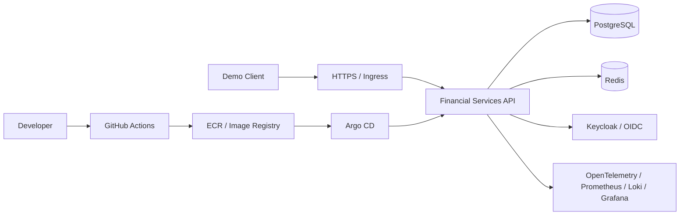

# SecureCloud Enterprise

**Enterprise Secure Cloud-Native Platform — a hands-on DevSecOps and platform engineering portfolio project**

> **Status:** Architecture and repository baseline in preparation. The components below describe the **planned target**, not features already deployed. Verified implementation evidence will be added as milestones are completed.

## The challenge

A fictional financial services provider needs to release changes frequently without compromising security, reliability or traceability. The platform includes customer authentication, synthetic accounts, simulated transactions, notifications, audit events and restricted administrative actions. The goal is to **design, build, secure, deploy, observe and recover** the complete platform using modern DevSecOps practices.

**This is a learning/portfolio system.** It does not process real payments or store real customer information.

## Target capabilities

- Secure API and synthetic financial-services workflows.
- Reproducible local development and AWS infrastructure.
- Containerized application, Kubernetes orchestration and Helm packaging.
- CI validation, GitOps deployments, policy enforcement and supply-chain verification.
- OIDC identity, secrets management, least-privilege cloud access and security scans.
- Metrics, logs, traces, alerts, autoscaling, backup and recovery exercises.
- Reproducible setup, engineering documentation, Git history and validated evidence.

## Technology stack (planned)

| Area | Stack |
|---|---|
| Application | NestJS (default; Spring Boot only by an approved ADR), PostgreSQL, Redis |
| Developer tooling | Git, Python, Bash, pre-commit |
| CI | GitHub Actions; Jenkins comparison |
| AWS | VPC, EC2, IAM, EKS, ECR, S3 |
| Infrastructure | Terraform, Ansible |
| Containers / orchestration | Docker, BuildKit, Kubernetes, Helm |
| GitOps / networking | Argo CD, AWS Load Balancer Controller, Ingress or Gateway API |
| Identity / secrets | Keycloak, OIDC, AWS Secrets Manager, External Secrets Operator |
| Policy / scanning | Kyverno or OPA Gatekeeper; Semgrep, Trivy, Checkov, Gitleaks |
| Supply chain | Syft, Cosign, SBOM |
| Observability / reliability | Prometheus, Grafana, Loki, OpenTelemetry, HPA, PDB, backups and recovery drills |

## High-level architecture (target, not yet deployed)



See [`PROJECT_BLUEPRINT.md`](PROJECT_BLUEPRINT.md) for the approved target design and scope. Architecture diagrams will be revised to match actual implementation.

## Implementation status

| Milestone | Status |
|---|---|
| Project baseline and architecture | Baseline merged via PR #2; WSL/Linux Git and local synchronization verified; VS Code WSL confirmed by learner; checkpoint-record publication and Phase 01 architecture work pending |
| API and local containers | Not verified |
| AWS and Terraform | Not verified |
| Kubernetes, Helm and GitOps | Not verified |
| Identity, secrets and policy | Not verified |
| Security and supply-chain controls | Not verified |
| Observability and recovery | Not verified |

For the current verified state, see [`PROJECT_PROGRESS.md`](PROJECT_PROGRESS.md).

## Getting started

**Prerequisites (initial stage):** Windows 11 with WSL2 Ubuntu, Git and VS Code with WSL support. Other tools are installed as required by the corresponding phase.

```bash
# Open the actual Linux repository path (adjust if different).
cd ~/devsecops-mastery/01-secure-cloud-platform

# Verify the workspace and repository before changing anything.
pwd
git status
git branch --show-current
```

**Application start commands:** Not yet established. Do not assume `docker compose up`, `npm run start`, Helm installs or cloud deployment commands work until implemented and verified. This section must be updated with tested commands, prerequisites, ports, environment variable names (not values), validation and teardown instructions as components become operational.

## Repository navigation

- [`PROJECT_BLUEPRINT.md`](PROJECT_BLUEPRINT.md) — authoritative requirements, architecture and roadmap.
- [`PROJECT_PROGRESS.md`](PROJECT_PROGRESS.md) — verified phase progress, daily work and handover.
- [`ENGINEERING_GUIDE.md`](ENGINEERING_GUIDE.md) — concise explanations, commands and verification procedures.
- [`INTERVIEW_PREPARATION.md`](INTERVIEW_PREPARATION.md) — interview questions learned during each section.
- [`AGENTS.md`](AGENTS.md) — AI engineering workflow and project documentation policy.

As implementation grows, this README will link to `docs/architecture/`, `docs/security/`, `docs/runbooks/`, infrastructure code, deployment manifests and test evidence.

## Development and contribution workflow

1. Read the blueprint and current progress before beginning a task.
2. Work on a dedicated feature branch (`feature/pNN-description`) from the approved base.
3. Implement and validate one milestone at a time; capture evidence.
4. Update relevant documentation and check for exposed secrets.
5. Review, commit and push the branch; open a PR to protected `main` when configured.
6. Merge only after required checks and review; record the checkpoint in `PROJECT_PROGRESS.md`.

## Security and cost notes

- Synthetic data only; no real customer records, financial transactions or credentials.
- Never commit `.env`, cloud keys, private keys, Terraform state or secrets.
- Cloud deployments require an explicit cost estimate, approval and teardown plan.
- Do not interpret a planned security control as implemented until its validation evidence is available.

## Evidence and demos

[PR #2: documentation baseline](https://github.com/Kashmitha/secure-cloud-platform/pull/2) is merged; baseline commit 1ac55f2, merge commit c3c2474. This is documentation/Git workflow evidence only.

Application demonstrations, successful pipeline runs, policy-denial evidence, dashboards, and recovery results will be added **after verification**. None is claimed by the documentation baseline.

## Learning outcomes

The project is intended to demonstrate cloud architecture, Infrastructure as Code, secure CI/CD, Kubernetes operations, GitOps, cloud identity, software supply-chain security, observability, resilience, cost awareness and practical troubleshooting.

---

*Maintained incrementally as an engineering portfolio. Documentation reflects verified work rather than marketing claims.*
